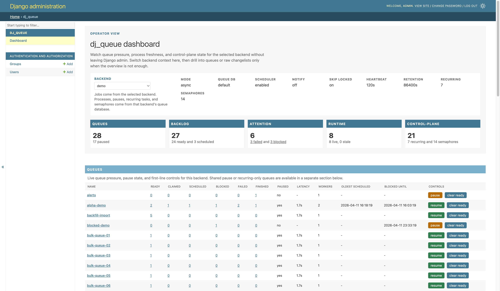
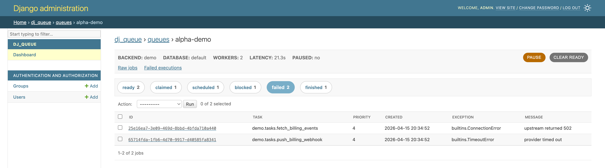

# dj_queue

[](https://github.com/coriocactus/dj_queue/actions/workflows/ci.yml)
[](https://pypi.org/project/dj-queue/)
[](https://djangopackages.org/packages/p/dj-queue/)


[](https://github.com/coriocactus/dj_queue/blob/main/LICENSE)

`dj_queue` is a database-backed task queue backend for Django's [`django.tasks`](https://docs.djangoproject.com/en/6.0/topics/tasks/) framework, inspired by Rails' [Solid Queue](https://github.com/rails/solid_queue).

Queue state, runtime process metadata, concurrency semaphores, recurring schedules, and task results live in Django-managed SQL tables. No Redis, RabbitMQ, or separate result store is required. PostgreSQL is the first-class production backend; MySQL, MariaDB, and SQLite are supported at Django's database version floors.

## Why dj_queue

Django applications already treat the relational database as the durable system of record. `dj_queue` executes immediate, scheduled, recurring, and concurrency-limited work on that same store:

- application code defines callables with Django's standard `@task` decorator (`def` and `async def`)
- `DjQueueBackend` persists jobs, execution states, and return values through a single transactional operations layer
- polling is the correctness path on every supported database; `SELECT ... FOR UPDATE SKIP LOCKED` and PostgreSQL `LISTEN`/`NOTIFY` are optional latency and throughput optimizations
- runtime supervision (`fork` or `async`), operational controls, Django admin views, health checks, and Prometheus/JSON telemetry ship in one package

For trade-offs against Celery, RQ, Procrastinate, Huey, and other `django.tasks` backends, see [docs/COMPARISONS.md](docs/COMPARISONS.md). For throughput and contention measurements across supported databases, see [docs/benchmarks/](docs/benchmarks/).

## Table of contents

- [Installation](#installation)
- [Quick start](#quick-start)
- [Concepts](#concepts)
- [Enqueueing and results](#enqueueing-and-results)
- [Running the runtime](#running-the-runtime)
- [Recurring tasks](#recurring-tasks)
- [Concurrency controls](#concurrency-controls)
- [Queue and job operations](#queue-and-job-operations)
- [Admin dashboard](#admin-dashboard)
- [Monitoring and health](#monitoring-and-health)
- [Configuration reference](#configuration-reference)
- [Multi-database setup and backend coexistence](#multi-database-setup-and-backend-coexistence)
- [Embedded server mode](#embedded-server-mode)
- [Database support](#database-support)
- [Rolling upgrades](#rolling-upgrades)
- [PostgreSQL maintenance](#postgresql-maintenance)
- [Examples](#examples)

## Installation

`dj_queue` requires Python 3.12+ and Django 6.0 or 6.1. The distribution ships inline type annotations and a PEP 561 `py.typed` marker.

```bash
pip install dj-queue
```

Optional extras:

```bash
pip install "dj-queue[postgres]" "psycopg[binary]"  # PostgreSQL + LISTEN/NOTIFY
pip install "dj-queue[prometheus]"                  # /dj_queue/metrics endpoint
```

On PostgreSQL, `dj-queue[postgres]` depends on `psycopg>=3.3.3` without forcing a C extension build. Install `psycopg[binary]` (bundled `libpq`) or `psycopg[c]` (system `libpq`); running on pure-Python `psycopg` requires a system `libpq`, reduces throughput, and emits a `psycopg_pure_python.warning` log event at supervisor startup. For MySQL or MariaDB, install a standard Django-compatible database driver.

Configure `INSTALLED_APPS`, `DATABASE_ROUTERS`, and `TASKS` in `settings.py`:

```python
INSTALLED_APPS = [
  # ...
  "dj_queue",
]

DATABASE_ROUTERS = ["dj_queue.routers.DjQueueRouter"]

TASKS = {
  "default": {
    "BACKEND": "dj_queue.backend.DjQueueBackend",
    "QUEUES": [],
    "OPTIONS": {},
  },
}
```

`DjQueueRouter` is optional when all queue tables live on `DATABASES["default"]`, and required for a [dedicated queue database](#dedicated-queue-database). For mixing `dj_queue` with other `django.tasks` backends, see [Backend coexistence](#backend-coexistence).

Apply migrations:

```bash
python manage.py migrate
```

## Quick start

Define a task in your Django app:

```python
# myapp/tasks.py
from django.tasks import task


@task
def add(a: int, b: int) -> int:
  return a + b
```

Start the runtime supervisor:

```bash
python manage.py dj_queue
```

With the default configuration, this starts one supervisor with one worker (`3` threads, all queues `"*"`), one dispatcher, and a scheduler (because finished-job cleanup is on by default).

Enqueue the task and read its persisted result:

```python
from myapp.tasks import add

result = add.enqueue(3, 7)
fresh = add.get_backend().get_result(result.id)
print(fresh.status, fresh.return_value)
```

Once a worker executes the job, `fresh.status` is `TaskResultStatus.SUCCESSFUL` and `fresh.return_value` is `10`.

## Concepts

### Terminology and routing

`dj_queue` separates callable definitions, persisted records, and routing scopes:

- **task**: a Python callable (`def` or `async def`) decorated with `@django.tasks.task`.
- **job**: one persisted record in `dj_queue_jobs` created when a task is enqueued. Its UUID primary key is `TaskResult.id`.
- **recurring task**: a schedule definition in `dj_queue_recurring_tasks` that enqueues jobs over time.
- **queue** (`queue_name`): a named lane within a backend alias (default `"default"`). Enqueueing validates `queue_name` against `TASKS[backend_alias]["QUEUES"]` when that list is non-empty.
- **backend alias**: a key in `settings.TASKS` with `"BACKEND": "dj_queue.backend.DjQueueBackend"`. Each backend alias scopes its own runtime topology, jobs, pauses, process rows, recurring tasks, admin views, and metrics.
- **database alias**: a key in `settings.DATABASES` selected by `OPTIONS["database_alias"]` (default `"default"`). It determines where that backend's queue and control tables reside.

Common deployment layouts combine one backend alias on `default` (simplest start), one backend alias on a [dedicated queue database](#dedicated-queue-database) (recommended for production), multiple backend aliases sharing one database (logical isolation without extra migrations), or multiple backend aliases on separate databases (full storage isolation).

### Job lifecycle

Every live job has at most one execution-state row (`dj_queue_*_executions`). Finished jobs have `finished_at` set and no execution-state row; successful jobs are deleted instead when `preserve_finished_jobs=False`. Operator discards (`discard_*` helpers, `QueueInfo.clear()`, admin) delete the job row; `on_conflict="discard"` keeps it as `finished`.

| Job state | Persisted representation | `TaskResult.status` | Transition summary |
|---|---|---|---|
| `ready` | `ReadyExecution` | `READY` | Eligible to be claimed by a worker matching `queue_name`. |
| `scheduled` | `ScheduledExecution` | `READY` | Deferred until `scheduled_at <= now()`, then promoted by a dispatcher. |
| `blocked` | `BlockedExecution` | `READY` | Waiting for a concurrency semaphore slot; promoted to `ready` on slot handoff or maintenance. |
| `claimed` | `ClaimedExecution` | `RUNNING` | Locked by a registered worker process and executing in its thread pool. |
| `failed` | `FailedExecution` | `FAILED` | Task raised, could not be imported, returned non-JSON data, or lost its worker process; kept until retried, discarded, or pruned. |
| `finished` | `Job.finished_at != None` | `SUCCESSFUL` | Completed normally (with `return_value`), or discarded at enqueue/dispatch by `on_conflict="discard"` (`return_value=None`). |

Due `scheduled` jobs and retried `failed` jobs re-enter the dispatch path (`ready`, `scheduled`, `blocked`, or `finished` on discard-conflict); `blocked` jobs move only to `ready`. No promotion goes directly to `claimed`. If external data corruption leaves a job with multiple execution-state rows or combines `finished_at` with an execution-state row, `Job.status` reports `"invalid"` and `get_result()` returns `FAILED` with a `DjQueueError` diagnostic.

### Runtime components

| Component | Responsibility |
|---|---|
| `supervisor` | Registers a `Supervisor` process row, starts and monitors runners ([`fork` child processes or `async` threads](#supervision-modes-and-topology)), replaces exited runners, fails orphaned claims, and prunes stale process rows. |
| `worker` | Claims `ready` jobs matching its queue selectors, executes tasks in a thread pool, records `finished` or `failed` transitions, and releases or hands off concurrency slots. |
| `dispatcher` | Promotes due `scheduled` jobs and due `failed` retries (`retry_at <= now()`) in batches, deletes unused expired semaphores, and retries expired `blocked` jobs. |
| `scheduler` | Syncs static recurring tasks at startup, fires due recurring tasks with database deduplication, and runs configured [retention cleanup](#deduplication-and-retention-cleanup). |

## Enqueueing and results

`DjQueueBackend` sets `supports_async_task = True`, `supports_defer = True`, `supports_get_result = True`, and `supports_priority = True`. Both synchronous (`enqueue`, `enqueue_all`, `get_result`) and asynchronous (`aenqueue`, `aenqueue_all`, `aget_result`) backend methods are implemented.

### Task options and scheduling

Use `.using(...)` or `@task(...)` arguments to set `queue_name`, `priority` (integer `-100` to `100`, default `0`; higher runs first), `run_after` (`datetime` for `scheduled` execution), `backend` (backend alias), and `@task(takes_context=True)` to receive a `django.tasks.TaskContext`:

```python
from datetime import timedelta
from django.tasks import TaskContext, task
from django.utils import timezone


@task(queue_name="email", priority=10, takes_context=True)
def send_digest(context: TaskContext, kind: str) -> str:
  return f"{context.task_result.id}:{kind}"


due = timezone.now() + timedelta(hours=1)
send_digest.using(run_after=due, priority=-5).enqueue("daily")
```

### Bulk enqueue

`DjQueueBackend.enqueue_all()` and `aenqueue_all()` validate and insert a batch of `(task, args, kwargs)` tuples in one transaction, grouping concurrency slot acquisition and deferring wakeup notifications until commit:

```python
from myapp.tasks import add

backend = add.get_backend()
results = backend.enqueue_all([(add, [i, 1], {}) for i in range(100)])
```

If any item in the batch fails validation, the entire batch raises `EnqueueError` before inserting rows.

### Transaction commit ordering

`enqueue()` writes to the queue database immediately and returns a persisted `TaskResult`. It never defers writes implicitly or returns placeholder IDs. When a task reads rows written in an open database transaction, defer the enqueue until that transaction commits with `enqueue_on_commit()`:

```python
from django.db import transaction
from dj_queue.api import enqueue_on_commit
from myapp.tasks import add

with transaction.atomic():
  enqueue_on_commit(add, 3, 7)
```

Pass `using="<db_alias>"` to `enqueue_on_commit()` when wrapping a transaction on a non-`default` application database. Because `using` selects the `transaction.on_commit()` database alias, tasks that take a keyword argument literally named `using` should call `transaction.on_commit(lambda: task.enqueue(..., using=...), using=...)` directly.

### Result retrieval

`backend.get_result(result_id)` and `await backend.aget_result(result_id)` load the persisted `Job` for that backend alias and return a `django.tasks.TaskResult`, or raise `django.tasks.exceptions.TaskResultDoesNotExist` if the job does not exist, belongs to another backend alias, or was deleted (`preserve_finished_jobs=False`, discarded, or pruned).

Async backend calls (`aenqueue`, `aenqueue_all`, `aget_result`) wrap the sync implementation via `asgiref.sync.sync_to_async`, closing obsolete Django connections before and after each call; see [`async_thread_sensitive` and `async_close_connections`](#global-options) to customize threading and connection teardown.

### Payload and result serialization

Task `args`, `kwargs`, and `return_value` are stored in JSON columns and must round-trip strictly through JSON (`NaN`, `Infinity`, `-Infinity`, non-string dict keys, and arbitrary Python objects are rejected):

- non-JSON `args` or `kwargs` raise `EnqueueError` at enqueue time
- a non-JSON `return_value` transitions the claimed job to `failed` (`ValueError: return value must be JSON round-trippable`)

Pass primary keys or explicit primitive representations rather than ORM model instances or file handles.

### Enqueue validation and exceptions

`DjQueueBackend.enqueue()` and `enqueue_all()` raise `EnqueueError` when:

- `queue_name` is outside a non-empty `TASKS[backend_alias]["QUEUES"]` allow-list
- `priority` is not an `int` (booleans are rejected) or is outside `-100..100`
- `args` or `kwargs` fail [payload serialization](#payload-and-result-serialization)
- `concurrency_key` is set without `concurrency_limit`, cannot be formatted from the bound arguments, or resolves to `""`, a non-string, or more than 255 characters (arguments that do not bind to the task signature raise `TypeError`)
- `concurrency_limit` or `concurrency_duration` is not a positive integer, or `on_conflict` is not `"block"` or `"discard"`

Exceptions defined in `dj_queue.exceptions`:

| Exception | Base | Description |
|---|---|---|
| `DjQueueError` | `Exception` | Base exception class for all `dj_queue`-specific errors. |
| `EnqueueError` | `DjQueueError` | Validation failure on enqueue or dynamic recurring registration, or an execution-state precondition conflict. |
| `DispatchPolicyError` | `EnqueueError` | Persisted or imported task concurrency policy cannot be resolved during promotion, retry, or recovery. |
| `ProcessExitError` | `DjQueueError` | Recorded on `FailedExecution` when a supervised runner exits or stops while holding a claimed job. |
| `ProcessMissingError` | `DjQueueError` | Recorded on `FailedExecution` when a `ClaimedExecution` row has no registered `Process` row. |
| `ProcessPrunedError` | `DjQueueError` | Recorded on `FailedExecution` when a runner's heartbeat expires (`process_alive_threshold`) and its process row is pruned. |

## Running the runtime

### Supervisor command

```bash
python manage.py dj_queue [--backend BACKEND] [--config CONFIG] [--mode {fork,async}] \
  [--only-work | --only-dispatch] [--skip-recurring] [--migration-wait-timeout SECONDS]
```

Before starting runners, `dj_queue` checks the backend's configured `database_alias` for unapplied `dj_queue` migrations and polls every `0.5s` up to `--migration-wait-timeout` seconds so rolling deployments can finish `migrate` concurrently. If pending migrations remain at the deadline, the command exits with `CommandError`. See [Precedence and validation](#precedence-and-validation) for how CLI flags interact with environment variables and settings.

| Flag | Type | Default | Description |
|---|---|---|---|
| `--backend` | `str` | `"default"` | `TASKS` backend alias to supervise; must use `DjQueueBackend`. |
| `--config` | `str \| None` | `None` | Path to a TOML options overlay file. |
| `--mode` | `str \| None` | `None` | Standalone supervision mode (`"fork"` or `"async"`). |
| `--only-work` | `bool` | `False` | Start workers only, without dispatchers or scheduler; cannot be combined with `--only-dispatch`. |
| `--only-dispatch` | `bool` | `False` | Start dispatchers only, without workers or scheduler; cannot be combined with `--only-work`. |
| `--skip-recurring` | `bool \| None` | `None` | Suppress the scheduler even when recurring or cleanup work is configured. |
| `--migration-wait-timeout` | `float` | `60` | Seconds (`>= 0`) to wait for pending `dj_queue` migrations on `database_alias` (`0` fails immediately). |

### Supervision modes and topology

- **`fork` mode** (default): `ForkSupervisor` spawns each configured worker process, dispatcher, and scheduler as a separate OS child process and monitors them with `waitpid()`.
- **`async` mode**: `AsyncSupervisor` runs workers, dispatchers, and the scheduler on managed threads inside a single OS process, lowering memory footprint at the cost of process-level isolation and sharing one Python GIL. Worker `processes > 1` is normalized to `1` with a `UserWarning`.

Crashed runners in both modes are replaced immediately the first time, then after `0.1s` doubling up to `30s` on repeated crashes; the backoff resets once a runner stays up for `60s`.

Multiple hosts may run against the same queue database concurrently; workers, dispatchers, and schedulers coordinate through database locks and unique constraints. In multi-node deployments, keep static `recurring` definitions identical across full nodes and prefer one full `manage.py dj_queue` instance alongside additional `manage.py dj_queue --only-work` nodes. Add `--only-dispatch` nodes only when you need more scheduled-job promotion or concurrency-maintenance throughput. Set [`supervisor_pidfile`](#global-options) to prevent duplicate standalone supervisors on the same host.

### Queue selectors and claiming order

Worker `queues` accepts a string or an ordered sequence of selector strings:

- `"*"` matches all queues (any selectors listed after `"*"` are unreachable and ignored)
- `"<prefix>*"` matches queue names starting with `<prefix>` (for example, `"email*"`)
- `"<name>"` matches an exact queue name

Claiming drains selectors strictly in list order before considering `priority`:

1. selector position in `queues` (for `["email", "default"]`, all unpaused `email` work is claimed before `default`, regardless of priority)
2. `priority` descending (`100` down to `-100`)
3. FIFO (`ReadyExecution.id` ascending)

Avoid combining multi-queue selector ordering with cross-queue priority expectations on the same worker; dedicate separate worker entries when distinct queue lanes need independent priority ordering.

### Signals, shutdown, and recovery

Standalone supervisors (`manage.py dj_queue` in `fork` or `async` mode) own OS signal handling:

- `SIGTERM` and `SIGINT` request graceful shutdown, stop new claims, wait up to `shutdown_timeout` seconds (shared across all supervised runners), deregister process rows, release `supervisor_pidfile`, and exit with status `0`.
- At the `shutdown_timeout` deadline, `ForkSupervisor` sends `SIGKILL` to remaining child processes and fails their claimed jobs with `ProcessExitError`. In `async` and embedded modes, worker threads cannot be forcibly terminated; a worker that exceeds `shutdown_timeout` sets `shutdown_state="draining"` in `Process.metadata`, continues heartbeating until in-flight threads finish, and then deletes its process row.
- `SIGQUIT` sets `shutdown_timeout` to `0`, runs process-row and pidfile cleanup (`SIGKILL` to remaining `fork` children; waits for active job threads in `async` mode), and exits with status `1`.
- Unrequested supervisor termination (such as an unhandled supervisor poll failure or a pruned supervisor row) exits with status `1`.

Supervisor housekeeping runs on a bounded heartbeat cadence (`max(min(process_alive_threshold, max(process_heartbeat_interval, 1)), 1)` seconds, or `max(min(process_alive_threshold, 60), 1)` when `process_heartbeat_interval == 0`). Each pass recovers at most `500` claimed jobs in total: orphaned claims first (`ProcessMissingError`), then claims held by stale process rows older than `process_alive_threshold`, which it prunes (`ProcessPrunedError`). When `dj_queue` owns the transaction, queue state transitions retry transient database deadlocks and lock-wait timeouts up to `3` attempts; task functions run outside terminal-transition retries and are never repeated.

### Lifecycle hooks

Register callbacks in `dj_queue.hooks` during Django startup (for example, `AppConfig.ready()`). Each callback receives the runner's `dj_queue.models.Process` instance (`name`, `kind`, `pid`, `hostname`, `backend_alias`, `metadata`). On `*.exit` events, the row has already been deleted from `dj_queue_processes` and the detached `Process` model instance is passed.

```python
from dj_queue.hooks import on_start, on_worker_start, register_hook


@on_start
def supervisor_started(process):
  print(process.name, process.backend_alias)


@on_worker_start
def worker_started(process):
  print(process.metadata["queues"])


@register_hook("scheduler.exit")
def scheduler_exited(process):
  print(process.name)
```

| Event | Decorator | Description |
|---|---|---|
| `supervisor.start`, `supervisor.stop`, `supervisor.exit` | `on_start`, `on_stop`, `on_exit` | Fired after supervisor registration, when stop begins, and after deregistration. |
| `worker.start`, `worker.stop`, `worker.exit` | `on_worker_start`, `on_worker_stop`, `on_worker_exit` | Fired for each worker runner lifecycle transition. |
| `dispatcher.start`, `dispatcher.stop`, `dispatcher.exit` | `on_dispatcher_start`, `on_dispatcher_stop`, `on_dispatcher_exit` | Fired for each dispatcher runner lifecycle transition. |
| `scheduler.start`, `scheduler.stop`, `scheduler.exit` | `on_scheduler_start`, `on_scheduler_stop`, `on_scheduler_exit` | Fired for each scheduler runner lifecycle transition. |

`register_hook(event, fn=None)` supports both decorator and direct call forms; `clear_hooks(event=None)` removes hooks for one event or all events. Callbacks run in registration order; exceptions are isolated and routed to [`on_thread_error`](#structured-log-events-and-error-callbacks) without blocking subsequent hooks.

## Recurring tasks

Recurring tasks are executed by the built-in `scheduler` runner; no separate beat service or external cron daemon is required. Each `RecurringTask` row caches its `next_run_at` timestamp so polls skip rows that are not due.

### Static recurring tasks

Declare static schedules under `TASKS[backend_alias]["OPTIONS"]["recurring"]`:

```python
TASKS = {
  "default": {
    "BACKEND": "dj_queue.backend.DjQueueBackend",
    "QUEUES": [],
    "OPTIONS": {
      "recurring": {
        "nightly_cleanup": {
          "task_path": "myapp.tasks.cleanup",
          "schedule": "0 3 * * *",
          "args": [],
          "kwargs": {"dry_run": False},
          "queue_name": "maintenance",
          "priority": -5,
          "description": "nightly cleanup",
        },
      },
    },
  },
}
```

Static definitions are validated at config load (`ImproperlyConfigured` on bad `task_path`, `schedule`, `priority`, or disallowed `queue_name`) and synchronized into `dj_queue_recurring_tasks` (`static=True`) when the scheduler starts, removing stale static rows no longer in settings and refusing to overwrite an existing dynamic key. See [Static recurring task options](#static-recurring-task-options) for all fields.

### Dynamic recurring tasks

Enable dynamic polling with `OPTIONS["scheduler"]["dynamic_tasks_enabled"] = True`, then manage schedules at runtime via `dj_queue.api`:

```python
from dj_queue.api import schedule_recurring_task, unschedule_recurring_task

schedule_recurring_task(
  key="tenant_42_report",
  task_path="myapp.tasks.send_report",
  schedule="every day at 08:00 in Europe/Rome",
  kwargs={"tenant_id": 42},
  queue_name="reports",
  priority=5,
)

unschedule_recurring_task("tenant_42_report")
```

Recurring task `key` values are unique per `backend_alias`. `schedule_recurring_task()` updates existing dynamic rows in place (resetting `next_run_at` when `schedule` changes) and raises `EnqueueError` if `key` belongs to static configuration. `unschedule_recurring_task()` deletes only dynamic rows (`static=False`), returning `1` when deleted and `0` when missing or static.

### Schedule syntax

Schedules are parsed by `dj_queue`'s built-in [Fugit](https://github.com/floraison/fugit#fugitcron)-compatible parser. Call `dj_queue.cron.validate_cron(schedule: str) -> None` to validate an expression directly (`ValueError` or `TypeError` on invalid input).

- **Cron fields and presets**: 5 fields (`minute hour day-of-month month day-of-week`) or 6 fields with a leading `seconds` field. Supported presets are `@yearly`, `@annually`, `@monthly`, `@weekly`, `@daily`, `@midnight`, `@noon`, and `@hourly`.
- **Cron extensions**: month and weekday names (`JAN`–`DEC`, `SUN`–`SAT`), steps, lists, wraparound ranges, `L`/`last` and negative monthdays (`-1` is the last day of the month), weekday `#` (`1#2` = second Monday, `5#-1` = last Friday), and weekday modulo `%` (`1%2` = every other Monday). Day-of-month and day-of-week use OR semantics unless `&` is suffixed to either field to require both to match. An IANA timezone or UTC offset may trail the expression (for example, `"30 1 * * * America/New_York"` or `"+02:00"`).
- **Natural-language expressions**: `every`, `at`, `on`, `from`, and `in <timezone>` clauses, ordinal monthdays, and weekday/hour ranges—such as `"every 5 minutes"`, `"every day at noon"`, `"every weekday at five"`, `"every month on day 2 at 10:00"`, `"from monday to friday at 9"`, `"at minute 5"`, and multi-time unions like `"every day at 16:15 and 18:30"`. Natural interval counts must fit within their cron field; misleading intervals such as `"every 90 seconds"`, `"every 90 minutes"`, and `"every 24 hours"` are rejected.
- **Calendar validation and DST**: schedules that can never fire (such as `"0 0 31 2 *"` or `"0 0 31 * 1#1&"`) are rejected. Timezone-suffixed schedules follow local wall-clock time: during a fall-back overlap, daily and hourly schedules fire once at the first occurrence while sub-hourly schedules fire across both hours; times skipped by a spring-forward transition do not fire that day.

### Deduplication and retention cleanup

The scheduler starts automatically whenever at least one of the following holds (unless `--only-work`, `--only-dispatch`, or `--skip-recurring` is active):

- `OPTIONS["recurring"]` is non-empty
- `OPTIONS["scheduler"]["dynamic_tasks_enabled"]` is `True`
- `preserve_finished_jobs` is `True` and `clear_finished_jobs_after` is not `None` (true by default: `86400s`)
- `clear_failed_jobs_after` is not `None`
- `clear_recurring_executions_after` is not `None`

Multiple schedulers deduplicate each `(backend_alias, task_key, run_at)` slot in `dj_queue_recurring_executions` with an `intended_job_id` allocated once per slot and reused when publication is retried, publishing the `Job` and its reservation attachment in one transaction (`500` slots max per poll). Internal retention cleanup runs at most once every `60s` (`500` rows max per class per pass) without creating user-visible recurring task rows.

## Concurrency controls

Decorate tasks with `@concurrency` from `dj_queue.api` to enforce database-backed semaphore limits:

```python
from django.tasks import task
from dj_queue.api import concurrency


@task
@concurrency(key="account:{account_id}", limit=1, duration=60, on_conflict="block")
def sync_account(account_id: int, action: str = "full") -> str:
  return f"{account_id}:{action}"
```

Both decorator orders (`@task` above `@concurrency` or `@concurrency` above `@task`) are supported.

| Name | Type | Default | Description |
|---|---|---|---|
| `key` | `str \| Callable[..., str]` | required | Format string bound against the task's call signature (excluding `TaskContext` when `takes_context=True`), or a callable invoked as `key(*args, **kwargs)`. Must resolve to a non-empty string of `<= 255` characters. |
| `limit` | `int` | required | Maximum concurrent `ready` plus `claimed` jobs holding the resolved key (`>= 1`). |
| `duration` | `int \| None` | `OPTIONS["default_concurrency_duration"]` | Semaphore lease TTL in seconds (`>= 1`) used by dispatcher maintenance to recover leaked slots if a worker dies without cleanup. |
| `on_conflict` | `Literal["block", "discard"]` | `"block"` | `"block"` inserts a `BlockedExecution` row until a slot frees or expires; `"discard"` marks the `Job` `finished` immediately (`return_value=None`, `TaskResultStatus.SUCCESSFUL`) without running the task. |

Concurrency policy (`concurrency_key`, `concurrency_limit`, `concurrency_duration`, `concurrency_on_conflict`) is snapshotted onto each `Job` row at enqueue time. When a claimed job finishes or fails, its slot is atomically handed to the highest-priority `blocked` waiter for the same backend alias (promoting that waiter to `ready`) or released back to `dj_queue_semaphores`.

`dj_queue_semaphores` rows are shared across the queue database (`database_alias`). When multiple backend aliases share one queue database and require isolated limits, prefix `key` with the backend alias.

## Queue and job operations

### Queue controls

`QueueInfo` inspects and mutates per-backend queue state:

```python
from dj_queue.api import QueueInfo

orders = QueueInfo("orders", backend_alias="default")
print(orders.size, orders.latency, orders.paused)

orders.pause()
orders.resume()
deleted = orders.clear()

for queue in QueueInfo.all(backend_alias="default"):
  print(queue.queue_name, queue.size, queue.paused)
```

- `size` returns the `ready` job count for `(backend_alias, queue_name)`.
- `latency` returns `None` while the queue is paused, `0.0` when unpaused with no `ready` jobs, or the age in seconds of the oldest `ready` job (excluding intervals spent paused before `resume()`).
- `pause()` prevents future claims on `(backend_alias, queue_name)` without blocking `enqueue()` or interrupting `claimed` jobs; `clear()` discards `ready` jobs only (releasing held concurrency slots).
- `QueueInfo.all()` discovers queues across ready, scheduled, claimed, blocked, failed, paused, and recurring rows in one snapshot and caches `size`, `latency`, and `paused` on each returned instance until `pause()`, `resume()`, or `clear()` is called on it.

### Job retry, discard, and manual execution

`dj_queue` does not run automatic retry or backoff policies; failed jobs retain `exception_class`, `message`, and `traceback` in `dj_queue_failed_executions` until acted on or pruned. Retry, schedule a future retry (`retry_at`, promoted by a dispatcher when due), or discard jobs by state (`claimed` jobs are never discardable):

```python
from datetime import timedelta
from django.utils import timezone
from dj_queue.api import (
  claim_ready_jobs,
  discard_blocked_jobs,
  discard_failed_job,
  discard_failed_jobs,
  discard_ready_jobs,
  discard_scheduled_jobs,
  execute_claimed_job,
  retry_failed_job,
  retry_failed_jobs,
  schedule_failed_job_retry,
)
from dj_queue.models import Job

failed_ids = list(Job.objects.failed().values_list("id", flat=True)[:2])
if failed_ids:
  schedule_failed_job_retry(failed_ids[0], retry_at=timezone.now() + timedelta(minutes=15))
  retry_failed_job(failed_ids[0])
if len(failed_ids) > 1:
  discard_failed_job(failed_ids[1])

retry_failed_jobs(batch_size=500)
discard_failed_jobs(batch_size=500)
discard_ready_jobs(batch_size=500)
discard_scheduled_jobs(batch_size=500)
discard_blocked_jobs(batch_size=500)

for claimed in claim_ready_jobs(limit=1, queues=["default"]):
  execute_claimed_job(claimed)
```

For read-only ORM inspection, `dj_queue.models.Job` provides `.status` (`"ready"`, `"scheduled"`, `"claimed"`, `"blocked"`, `"failed"`, `"finished"`, `"invalid"`, or `None`), boolean status properties, and `Job.objects` queryset filters (`.ready()`, `.scheduled()`, `.claimed()`, `.blocked()`, `.failed()`, `.finished()`, `.invalid_execution_state()`).

### Public Python API

All symbols exported in `dj_queue.api` (for schedule validation, see [`dj_queue.cron.validate_cron`](#schedule-syntax)):

| Symbol | Signature | Description |
|---|---|---|
| `ClaimedJob` | `(job: Job, claimed_at: datetime, worker_ids: tuple[str, ...], process_id: int \| None = None)` | Dataclass returned by `claim_ready_jobs()`. |
| `QueueInfo` | `(queue_name: str, *, backend_alias: str = "default")` | Queue read/control handle (`.size`, `.latency`, `.paused`, `.pause()`, `.resume()`, `.clear(*, batch_size=500)`, `QueueInfo.all(*, backend_alias="default")`). |
| `claim_ready_jobs` | `(*, limit: int, queues: str \| Sequence[str] \| None = None, process: Process \| None = None, backend_alias: str = "default", config=None) -> list[ClaimedJob]` | Atomically lock and claim up to `limit` unpaused `ready` jobs. |
| `execute_claimed_job` | `(job: ClaimedJob \| Job \| UUID \| str, *, backend_alias: str = "default", config=None) -> Job` | Run a claimed job's task callable and persist its `finished` or `failed` outcome. |
| `concurrency` | `(*, key: str \| Callable[..., str], limit: int, duration: int \| None = None, on_conflict: Literal["block", "discard"] = "block")` | Decorator attaching concurrency metadata to a task. |
| `enqueue_on_commit` | `(task: Task, *args: Any, using: str \| None = None, **kwargs: Any) -> None` | Register `task.enqueue(*args, **kwargs)` via `transaction.on_commit(using=using)`. |
| `schedule_recurring_task` | `(*, key: str, task_path: str, schedule: str, args: Sequence[Any] = (), kwargs: Mapping[str, Any] \| None = None, queue_name: str = "default", priority: int = 0, description: str = "", backend_alias: str = "default", config=None) -> RecurringTask` | Create or update a dynamic recurring task. |
| `unschedule_recurring_task` | `(key: str, *, backend_alias: str = "default", config=None) -> int` | Delete a dynamic recurring task; returns deleted count (`0` or `1`). |
| `retry_failed_job` | `(job_id: UUID \| str, *, backend_alias: str = "default", config=None) -> Job` | Redispatch one failed job immediately. |
| `retry_failed_jobs` | `(*, job_ids: Iterable[UUID \| str] \| None = None, batch_size: int = 500, backend_alias: str = "default", config=None) -> int` | Redispatch up to `batch_size` failed jobs; returns retried count. |
| `schedule_failed_job_retry` | `(job_id: UUID \| str, *, retry_at: datetime, backend_alias: str = "default", config=None) -> Job` | Set `FailedExecution.retry_at` without leaving the `failed` state until due. |
| `discard_failed_job` | `(job_id: UUID \| str, *, backend_alias: str = "default", config=None) -> int` | Delete one failed job and its `FailedExecution` row. |
| `discard_failed_jobs` | `(*, job_ids: Iterable[UUID \| str] \| None = None, batch_size: int = 500, backend_alias: str = "default", config=None) -> int` | Delete up to `batch_size` failed jobs. |
| `discard_ready_jobs` | `(*, job_ids: Iterable[UUID \| str] \| None = None, batch_size: int = 500, backend_alias: str = "default", config=None) -> int` | Delete up to `batch_size` ready jobs and release held concurrency slots. |
| `discard_scheduled_jobs` | `(*, job_ids: Iterable[UUID \| str] \| None = None, batch_size: int = 500, backend_alias: str = "default", config=None) -> int` | Delete up to `batch_size` scheduled jobs. |
| `discard_blocked_jobs` | `(*, job_ids: Iterable[UUID \| str] \| None = None, batch_size: int = 500, backend_alias: str = "default", config=None) -> int` | Delete up to `batch_size` blocked jobs. |

### Pruning retained rows

```bash
python manage.py dj_queue_prune [--backend BACKEND] [--older-than SECONDS] \
  [--failed-older-than SECONDS] [--recurring-older-than SECONDS] [--batch-size N] \
  [--task-path TASK_PATH] [--task-key TASK_KEY]
```

Deletes at most `--batch-size` rows per row class in one invocation and prints a notice when any class hits `--batch-size` so callers can re-run until drained.

| Flag | Type | Default | Description |
|---|---|---|---|
| `--backend` | `str` | `"default"` | `TASKS` backend alias to prune. |
| `--older-than` | `int \| None` | `clear_finished_jobs_after` | Minimum `finished_at` age in seconds (`>= 0`) for finished jobs; skipped when both flag and config option are `None`. |
| `--failed-older-than` | `int \| None` | `clear_failed_jobs_after` | Minimum age in seconds (`>= 0`) since the job failed (`FailedExecution.created_at`); skipped when both flag and config option are `None`. |
| `--recurring-older-than` | `int \| None` | `clear_recurring_executions_after` | Minimum `run_at` age in seconds (`>= 0`) for `dj_queue_recurring_executions`; skipped when both flag and config option are `None`. |
| `--batch-size` | `int` | `500` | Maximum rows (`>= 1`) deleted per row class per invocation. |
| `--task-path` | `str \| None` | `None` | Restrict finished- and failed-job deletion to one `task_path`. |
| `--task-key` | `str \| None` | `None` | Restrict recurring-execution deletion to one `task_key`. |

## Admin dashboard

When `django.contrib.admin` is installed, `dj_queue` mounts a backend-aware dashboard at `/admin/dj_queue/dashboard/` alongside read-only model changelists and detail views for `Job`, `FailedExecution`, `Process`, `RecurringTask`, `Pause`, and `Semaphore`.

- Job, failed-execution, process, pause, and recurring-task views filter by the selected `backend` query parameter; semaphore views scope to that backend's `database_alias`. `Job` and `FailedExecution` changelists omit full `COUNT(*)` totals to keep large tables responsive.
- Queue drill-down pages inspect `ready`, `scheduled`, `claimed`, `blocked`, `failed`, `finished`, and `invalid` tabs and execute bulk operations in batches of `500` job IDs per transaction.
- Active staff users (`is_active` and `is_staff`) can view the dashboard overview; drill-down pages and mutating actions require explicit Django model permissions (`403` when unauthorized, with unauthorized controls hidden):

| Action | Permission | Surface |
|---|---|---|
| `view` | `dj_queue.view_job` | Queue drill-down page (`/admin/dj_queue/dashboard/queue/<name>/`). |
| `enqueue` | `dj_queue.add_job` | Enqueue a fresh copy from non-scheduled `Job` detail or `finished` drill-down bulk action. |
| `enqueue_copy_now` | `dj_queue.add_job` | Enqueue an immediate (`run_after=None`) copy from a `scheduled` `Job` detail page. |
| `run_now` | `dj_queue.change_job` | Dispatch an existing `scheduled` job immediately from its `Job` detail page. |
| `retry` | `dj_queue.change_job` | Retry failed jobs from `Job` detail, `FailedExecution` detail/changelist, or `failed` drill-down. |
| `discard` | `dj_queue.delete_job` | Discard jobs from `Job`/`FailedExecution` views or `ready`, `scheduled`, `blocked`, and `failed` drill-downs. |
| `clear` | `dj_queue.delete_job` | Clear all `ready` jobs in a queue from dashboard or queue drill-down controls. |
| `pause` | `dj_queue.add_pause` | Pause a queue from dashboard or queue drill-down controls. |
| `resume` | `dj_queue.delete_pause` | Resume a queue from dashboard, queue drill-down, or `Pause` detail controls. |
| `unschedule` | `dj_queue.delete_recurringtask` | Unschedule dynamic recurring tasks from `RecurringTask` changelist or detail views. |

**Dashboard overview**



**Queue drill-down**



## Monitoring and health

### Health check command

```bash
python manage.py dj_queue_health [--backend BACKEND] [--max-age SECONDS] \
  [--deep] [--require-version VERSION]
```

Prints `healthy` to `stdout` and exits `0` when at least one `Process` row for `--backend` has `last_heartbeat_at` within `--max-age` (and all enabled deep checks pass); otherwise writes failure reasons to `stderr` and exits `1`.

| Flag | Type | Default | Description |
|---|---|---|---|
| `--backend` | `str` | `"default"` | `TASKS` backend alias to check. |
| `--max-age` | `int \| None` | `process_alive_threshold` | Maximum heartbeat age in seconds (`>= 1`) for a process row to count as live. |
| `--deep` | `bool` | `False` | Also verify live process `rollout_protocol`, invalid job states or concurrency policies, denormalized backend/queue mismatches, claimed rows with missing or stale processes, incomplete or mismatched recurring reservations, impossible semaphore counts, failed jobs exceeding `clear_failed_jobs_after`, and PostgreSQL dead-tuple bloat (`>= 10,000` dead tuples and `>= 20%` dead-tuple ratio), reporting any sessions or slots pinning `xmin` when dead-tuple bloat is found. |
| `--require-version` | `str \| None` | `None` | Implies `--deep` and additionally requires every live queue process to report `dj_queue_version == VERSION`. |

### HTTP observability endpoints

Mount `dj_queue.urls` to expose JSON statistics and Prometheus metrics for all `dj_queue`-managed backend aliases:

```python
from django.urls import include, path

urlpatterns = [
  # ...
  path("dj_queue/", include("dj_queue.urls")),
]
```

- `GET /dj_queue/stats.json`: returns `{"backends": [...]}` with per-backend queue counts (`ready_count`, `scheduled_count`, `claimed_count`, `blocked_count`, `failed_count`), queue pause/latency/worker counts, runner liveness counts, recurring tasks, semaphores, failed-job retention metrics, and (on PostgreSQL) advisory read-only `pg_stat_user_tables` tuple/vacuum stats plus `pg_stat_activity`, `pg_replication_slots`, and `pg_prepared_xacts` xmin-blocker diagnostics (omitting usernames and client addresses).
- `GET /dj_queue/metrics`: returns Prometheus text exposition (`0.0.4`) when `dj-queue[prometheus]` is installed, or HTTP `503` with an installation hint when `prometheus_client` is absent.
- **Authentication**: set `DJ_QUEUE_OBSERVABILITY_TOKEN` in `settings.py` to require `Authorization: Bearer <token>` on both endpoints (returns `401` with `WWW-Authenticate: Bearer` otherwise). Leave it unset or `""` when access is restricted at the network or reverse-proxy layer.

### Prometheus metrics

| Metric | Type | Labels | Description |
|---|---|---|---|
| `dj_queue_queue_jobs` | `gauge` | `backend`, `queue`, `state` | Job count per queue and state (`ready`, `scheduled`, `claimed`, `blocked`, `failed`). |
| `dj_queue_queue_paused` | `gauge` | `backend`, `queue` | `1` when the queue is paused, `0` otherwise. |
| `dj_queue_queue_latency_seconds` | `gauge` | `backend`, `queue` | Age in seconds of the oldest `ready` job; omitted when the queue is paused or has no `ready` jobs. |
| `dj_queue_queue_live_workers` | `gauge` | `backend`, `queue` | Live `Worker` processes whose selectors match the queue. |
| `dj_queue_runner_processes` | `gauge` | `backend`, `status` | Process row count (all kinds) by liveness (`live`, `stale`). |
| `dj_queue_runner_processes_by_kind` | `gauge` | `backend`, `kind`, `status` | Process row count by kind (`Supervisor`, `Worker`, `Dispatcher`, `Scheduler`) and liveness (`live`, `stale`); kinds with no rows emit no samples. |
| `dj_queue_recurring_tasks` | `gauge` | `backend` | Configured `RecurringTask` row count. |
| `dj_queue_semaphores` | `gauge` | `queue_database` | `Semaphore` row count deduplicated by queue `database_alias`. |
| `dj_queue_process_rows` | `gauge` | `backend` | Total `Process` row count (`live` plus `stale`). |
| `dj_queue_failed_jobs` | `gauge` | `backend` | Current `FailedExecution` row count. |
| `dj_queue_failed_job_oldest_age_seconds` | `gauge` | `backend` | Age in seconds of the oldest failed job; omitted when failed count is `0`. |
| `dj_queue_failed_job_retention_seconds` | `gauge` | `backend` | Configured `clear_failed_jobs_after` seconds; omitted when `None`. |
| `dj_queue_failed_jobs_over_retention` | `gauge` | `backend` | Failed jobs older than `clear_failed_jobs_after`; omitted when `None`. |

### Structured log events and error callbacks

`dj_queue` logs structured records on the `"dj_queue"` logger without modifying `django.db.backends`. Domain events attach `record.event` and `record.dj_queue` (`{"backend_alias": ..., ...}`); runtime infrastructure errors attach flat `event`, `backend_alias`, `thread_error_context`, and `thread_error_type` extras:

| Event | Level | Fields | Description |
|---|---|---|---|
| `job.enqueued` | `INFO` | `backend_alias`, `job_id`, `task_path`, `queue_name`, `priority` | Single job enqueued. |
| `jobs.enqueued` | `INFO` | `backend_alias`, `job_count`, `ready_count`, `scheduled_count`, `blocked_count`, `discarded_count` | Bulk batch enqueued via `enqueue_all()`. |
| `job.claimed` | `INFO` | `backend_alias`, `job_id`, `queue_name`, `priority` | Ready job claimed by a worker. |
| `job.executed` | `INFO` | `backend_alias`, `job_id`, `status` | Claimed job completed (`status="success"`). |
| `job.failed` | `INFO` | `backend_alias`, `job_id`, `exception_class`, `message`, optional `failure_kind` | Job marked failed from task import/execution/serialization, dispatch policy, or process recovery. |
| `job.retried` | `INFO` | `backend_alias`, `job_id`, `queue_name`, `priority` | Failed job redispatched immediately or via due `retry_at`. |
| `job.discarded` | `INFO` | `backend_alias`, `job_id`, `reason` | Job discarded from `ready`, `scheduled`, `blocked`, or `failed` state. |
| `job.dispatched_now` | `INFO` | `backend_alias`, `job_id`, `queue_name`, `priority`, `dispatched_as` | Scheduled job dispatched immediately from admin. |
| `job.unblocked` | `INFO` | `backend_alias`, `job_id`, `concurrency_key` | Blocked job promoted to `ready`. |
| `queue.paused` | `INFO` | `backend_alias`, `queue_name` | Queue paused. |
| `queue.resumed` | `INFO` | `backend_alias`, `queue_name` | Queue resumed. |
| `process.pruned` | `INFO` | `backend_alias`, `process_name`, `pid` | Stale process row pruned by supervisor housekeeping. |
| `process.replaced` | `INFO` | `backend_alias`, `process_name`, `kind`, `old_pid`, `new_pid`, `exit_status` | Exited runner replaced by supervisor (`exit_status=None` in `async` mode). |
| `notify.restored` | `INFO` | `backend_alias` | PostgreSQL `LISTEN` connection restored after a disconnect. |
| `connection_budget.warning` | `WARNING` | `backend_alias`, `database_alias`, `estimated_worker_connections`, `available_database_connections`, `max_connections`, `reserved_connections`, `threshold` | Persistent connection estimate reached `75%` of PostgreSQL capacity at startup. |
| `psycopg_pure_python.warning` | `WARNING` | `backend_alias`, `database_alias`, `psycopg_implementation`, `install` | PostgreSQL runs on pure-Python `psycopg` (`install="psycopg[binary] or psycopg[c]"`). |
| `dj_queue.thread_error` | `ERROR` | `backend_alias`, `thread_error_context`, `thread_error_type` | Background runtime error when `on_thread_error` is unset or raised. |
| `dj_queue.thread_error_callback_failed` | `ERROR` | `backend_alias`, `thread_error_context`, `on_thread_error`, `thread_error_type` | Configured `on_thread_error` callback raised an exception. |

Set `OPTIONS["on_thread_error"]` to an importable dotted callable `def report(exc: Exception) -> None` to forward infrastructure exceptions (hook errors, heartbeat/liveness errors, `LISTEN`/`NOTIFY` errors, and runner crashes) to an error tracker. Task exceptions are recorded as `failed` jobs and are not sent to `on_thread_error`.

## Configuration reference

### Precedence and validation

Configuration for a `backend_alias` resolves from highest to lowest precedence:

1. CLI flags (`--mode`, `--only-work`, `--only-dispatch`, `--skip-recurring`, and `--config` for selecting the TOML path)
2. Environment variables (`DJ_QUEUE_MODE`, `DJ_QUEUE_SKIP_RECURRING`, and `DJ_QUEUE_CONFIG` when `--config` is omitted)
3. TOML options file (`--config` or `DJ_QUEUE_CONFIG`)
4. `TASKS[backend_alias]["OPTIONS"]` in Django settings
5. Built-in defaults

All option mappings must be JSON-serializable. Unknown keys in `OPTIONS` or in the TOML overlay—including nested `workers`, `dispatchers`, `scheduler`, and `recurring` entries—raise `ImproperlyConfigured` naming the section and key (such as `workers[0] contains unknown options: 'thread'`); invalid values name the full path (such as `workers[0].threads`). Boolean options accept `bool`, `0`/`1`, or case-insensitive `"1"`, `"true"`, `"yes"`, `"on"`, `"0"`, `"false"`, `"no"`, `"off"`; numeric options reject `bool`. All sections are validated before `--only-work`, `--only-dispatch`, or `--skip-recurring` prunes the active topology, and config loading fails if no worker, dispatcher, or scheduler workload remains.

### Global options

Configured under `TASKS[backend_alias]["OPTIONS"]`:

| Name | Type | Default | Description |
|---|---|---|---|
| `mode` | `str` | `"fork"` | Standalone supervisor mode: `"fork"` or `"async"`. |
| `workers` | `Sequence[Mapping] \| Mapping` | `[{"queues": "*", "threads": 3, "processes": 1, "polling_interval": 0.1, "prefetch_multiplier": 2}]` | Worker definitions (see [Worker options](#worker-options)). A single mapping is normalized to a one-item list. |
| `dispatchers` | `Sequence[Mapping] \| Mapping` | `[{"batch_size": 500, "polling_interval": 1, "concurrency_maintenance": True, "concurrency_maintenance_interval": 600}]` | Dispatcher definitions (see [Dispatcher options](#dispatcher-options)). A single mapping is normalized to a one-item list. |
| `scheduler` | `Mapping \| None` | `{"dynamic_tasks_enabled": False, "polling_interval": 5}` | Scheduler settings (see [Scheduler options](#scheduler-options)). `None` uses the defaults. |
| `recurring` | `Mapping[str, Mapping] \| None` | `{}` | Static recurring task definitions keyed by task key (see [Static recurring task options](#static-recurring-task-options)). |
| `database_alias` | `str` | `"default"` | `DATABASES` key storing queue and runtime tables for this backend alias. |
| `preserve_finished_jobs` | `bool` | `True` | Retain finished `Job` rows for result lookup and retention cleanup; `False` deletes `Job` rows on completion. |
| `clear_finished_jobs_after` | `int \| None` | `86400` | Seconds (`>= 0`) before scheduler cleanup deletes finished jobs (when `preserve_finished_jobs=True`); `None` disables cleanup. |
| `clear_failed_jobs_after` | `int \| None` | `None` | Seconds (`>= 0`) before scheduler cleanup deletes failed jobs; `None` disables cleanup. |
| `clear_recurring_executions_after` | `int \| None` | `None` | Seconds (`>= 0`) before scheduler cleanup deletes `dj_queue_recurring_executions` rows; `None` disables cleanup. |
| `default_concurrency_duration` | `int` | `180` | Default semaphore TTL in seconds (`>= 1`) when `@concurrency` omits `duration`. |
| `use_skip_locked` | `bool` | `True` | Enable `FOR UPDATE SKIP LOCKED` where the database supports it. |
| `listen_notify` | `bool` | `True` | Enable PostgreSQL `LISTEN`/`NOTIFY` worker wakeups on top of polling; the `LISTEN` connection uses the connection parameters of `database_alias`. |
| `async_thread_sensitive` | `bool` | `False` | Serialize `aenqueue()`, `aenqueue_all()`, and `aget_result()` in `asgiref`'s thread-sensitive lane. |
| `async_close_connections` | `bool` | `False` | Close all Django connections after each async backend call instead of only obsolete connections. |
| `process_heartbeat_interval` | `float` | `60` | Seconds (`>= 0`) between runner heartbeat writes (`0` falls back to `min(process_alive_threshold / 2, 60)`). |
| `process_alive_threshold` | `float` | `300` | Seconds (`> 0`) before a `Process` row is considered stale. |
| `shutdown_timeout` | `float` | `5` | Seconds (`>= 0`) shared across runners to drain in-flight work on graceful stop. |
| `supervisor_pidfile` | `str \| None` | `None` | Lock-backed pidfile path acquired by standalone supervisors (`standalone=True`). |
| `on_thread_error` | `str \| None` | `None` | Importable dotted callable `(exc) -> None` for runtime infrastructure exceptions (`""` treated as `None`). |

### Worker options

Each mapping in `OPTIONS["workers"]`:

| Name | Type | Default | Description |
|---|---|---|---|
| `queues` | `str \| Sequence[str]` | `"*"` | Queue selector or ordered list of selectors (`"*"`, exact name, or `"prefix*"`). |
| `threads` | `int` | `3` | Thread-pool size per worker runner (`>= 1`). |
| `processes` | `int` | `1` | OS processes launched for this entry in `fork` mode (`>= 1`); normalized to `1` in `async` mode. |
| `polling_interval` | `float` | `0.1` | Seconds (`> 0`) between ready-queue polls. |
| `prefetch_multiplier` | `int` | `2` | Upper bound (`threads * prefetch_multiplier`, `>= 1`) on in-flight plus queued claimed jobs; workers poll only while at least one thread is idle. |

### Dispatcher options

Each mapping in `OPTIONS["dispatchers"]`:

| Name | Type | Default | Description |
|---|---|---|---|
| `batch_size` | `int` | `500` | Maximum rows (`>= 1`) per scheduled promotion, due failed-retry promotion, expired semaphore cleanup, or expired blocked-job pass. |
| `polling_interval` | `float` | `1` | Seconds (`> 0`) between dispatcher polls. |
| `concurrency_maintenance` | `bool` | `True` | Run expired semaphore cleanup and expired blocked-job promotion. |
| `concurrency_maintenance_interval` | `float` | `600` | Seconds (`>= 0`) between concurrency maintenance passes; `0` runs on every poll. |

### Scheduler options

Configured under `OPTIONS["scheduler"]`:

| Name | Type | Default | Description |
|---|---|---|---|
| `dynamic_tasks_enabled` | `bool` | `False` | Poll dynamic recurring tasks (`static=False`) from `dj_queue_recurring_tasks`. |
| `polling_interval` | `float` | `5` | Seconds (`> 0`) between scheduler polls. |

### Static recurring task options

Each `<key>` mapping under `OPTIONS["recurring"]`:

| Name | Type | Default | Description |
|---|---|---|---|
| `task_path` | `str` | required | Non-empty dotted import path referencing a Django `Task`. |
| `schedule` | `str` | required | Valid Fugit-style cron or cronish schedule expression. |
| `args` | `Sequence[Any]` | `[]` | Positional arguments passed when enqueueing. |
| `kwargs` | `Mapping[str, Any]` | `{}` | Keyword arguments passed when enqueueing. |
| `queue_name` | `str` | `"default"` | Destination queue; must be in `TASKS[backend_alias]["QUEUES"]` when that allow-list is non-empty. |
| `priority` | `int` | `0` | Job priority (`-100` to `100`). |
| `description` | `str` | `""` | Operator-facing description. |

### TOML overlay

Pass `--config /etc/dj_queue.toml` or set `DJ_QUEUE_CONFIG=/etc/dj_queue.toml` to overlay `OPTIONS` without editing `settings.py`. The overlay replaces top-level options. A TOML `workers`, `dispatchers`, `scheduler`, or `recurring` value replaces the settings value entirely, and keys omitted inside it use built-in defaults. A file with `backends` may contain no other top-level keys; an alias missing from it gets no overlay. TOML has no `null`, so omit a top-level key to keep its settings value.

Flat overlay:

```toml
mode = "async"
database_alias = "queue"

[[workers]]
queues = ["default", "email*"]
threads = 8
```

Per-backend overlay:

```toml
[backends.default]
mode = "fork"
database_alias = "queue"
clear_finished_jobs_after = 86400

[[backends.default.workers]]
queues = ["critical", "default", "email*"]
threads = 8
processes = 2
polling_interval = 0.1
prefetch_multiplier = 2

[[backends.default.dispatchers]]
batch_size = 500
polling_interval = 1

[backends.default.scheduler]
dynamic_tasks_enabled = true
polling_interval = 5

[backends.default.recurring.nightly_cleanup]
task_path = "myapp.tasks.cleanup"
schedule = "0 3 * * *"
queue_name = "maintenance"
priority = -5
```

### Environment variables and Django settings

Environment variables read by `dj_queue` (see [Precedence and validation](#precedence-and-validation)):

| Name | Type | Default | Description |
|---|---|---|---|
| `DJ_QUEUE_CONFIG` | `str` | unset | Path to a TOML options overlay file. |
| `DJ_QUEUE_MODE` | `str` | unset | Standalone mode override: `"fork"` or `"async"`. |
| `DJ_QUEUE_SKIP_RECURRING` | `bool` | unset | Boolean string (`1`/`true`/`yes`/`on` or `0`/`false`/`no`/`off`) suppressing the scheduler. |

Django `settings.py` keys used by `dj_queue`:

| Name | Type | Default | Description |
|---|---|---|---|
| `TASKS` | `Mapping[str, Mapping]` | Django's `ImmediateBackend` `"default"` alias | Django task backend definitions (`BACKEND`, `QUEUES`, `OPTIONS`); `dj_queue` needs at least one alias whose `BACKEND` is `"dj_queue.backend.DjQueueBackend"`. |
| `DATABASE_ROUTERS` | `Sequence[str]` | `[]` | Include `"dj_queue.routers.DjQueueRouter"` for migration gating and single-queue-database ORM routing. |
| `DJ_QUEUE_OBSERVABILITY_TOKEN` | `str \| None` | `None` | Optional bearer token protecting `/dj_queue/stats.json` and `/dj_queue/metrics`. |

## Multi-database setup and backend coexistence

### Dedicated queue database

Isolate queue tables and connection pools on a dedicated `DATABASES` alias via `OPTIONS["database_alias"]`:

```python
DATABASES = {
  "default": {"ENGINE": "django.db.backends.postgresql", "NAME": "app"},
  "queue": {"ENGINE": "django.db.backends.postgresql", "NAME": "queue"},
}

DATABASE_ROUTERS = ["dj_queue.routers.DjQueueRouter"]

TASKS = {
  "default": {
    "BACKEND": "dj_queue.backend.DjQueueBackend",
    "QUEUES": [],
    "OPTIONS": {"database_alias": "queue"},
  },
}
```

Apply `dj_queue` migrations to `queue` and application migrations to `default`:

```bash
python manage.py migrate dj_queue --database queue
python manage.py migrate
```

`DjQueueRouter` permits `dj_queue` migrations only on database aliases referenced by configured `dj_queue` backends (and on none when no `dj_queue` backend is configured). When all `dj_queue` backends share one `database_alias`, the router directs `dj_queue` ORM reads and writes to it; when multiple `dj_queue` backends point at different `database_alias` targets, migrate each target with `--database <alias>`—the router leaves `dj_queue` ORM calls unrouted while `dj_queue` operations pass `using=` explicitly.

### Backend coexistence

`dj_queue` can share `settings.TASKS` with other `django.tasks` backends:

- when `TASKS = {}`, `dj_queue` exposes one implicit `"default"` backend alias with built-in defaults (leaving `TASKS` unset selects Django's `ImmediateBackend`, which `dj_queue` ignores)
- when `TASKS` is non-empty, `dj_queue` manages **only** aliases whose `"BACKEND"` equals `"dj_queue.backend.DjQueueBackend"`; aliases pointing at another backend class are ignored by `manage.py dj_queue*`, admin views, `/dj_queue/stats.json`, and `/dj_queue/metrics`, and targeting a non-`dj_queue` or missing-`BACKEND` alias raises `ImproperlyConfigured`

## Embedded server mode

For most deployments, start with a standalone `dj_queue` process; reach for a [dedicated queue database](#dedicated-queue-database) before embedded mode.

`dj_queue` can run an embedded `AsyncSupervisor(standalone=False)` inside an ASGI or Gunicorn server process, leaving OS signal handling to the host server. Startup runs synchronously so configuration errors surface immediately, and `supervisor.run()` executes on a daemon thread that enforces `shutdown_timeout` when the server exits. If the supervisor loop terminates, its runners deregister and it is not restarted inside that worker process.

### ASGI

Wrap your ASGI callable with `DjQueueLifespan(app, *, backend_alias="default", forward_wrapped_lifespan=True)`:

```python
from django.core.asgi import get_asgi_application
from dj_queue.contrib.asgi import DjQueueLifespan

django_application = get_asgi_application()
application = DjQueueLifespan(django_application, forward_wrapped_lifespan=False)
```

Pass `forward_wrapped_lifespan=False` when the wrapped application does not implement the ASGI `lifespan` protocol (such as Django's plain `get_asgi_application()`); keep the default `True` when wrapping middleware or frameworks with their own lifespan hooks.

### Gunicorn

Import the worker lifecycle hooks in `gunicorn.conf.py`:

```python
from dj_queue.contrib.gunicorn import post_fork, worker_exit
```

Across multiple Gunicorn workers in the same working directory and backend alias, `post_fork` coordinates via a non-blocking file lock in the system temp directory so only one Gunicorn worker runs the embedded supervisor at a time; sibling workers retry acquiring the lock every `1.0s` and take over automatically when the active worker recycles or exits. Set `dj_queue_backend_alias = "<alias>"` on the Gunicorn server or worker object to target a non-`default` backend alias.

## Database support

| Backend | Support level | Capabilities |
|---|---|---|
| PostgreSQL | First-class production backend | Polling, `FOR UPDATE SKIP LOCKED`, optional `LISTEN`/`NOTIFY` wakeups, and advisory table/xmin diagnostics. |
| MySQL | Supported | Polling and `FOR UPDATE SKIP LOCKED`. |
| MariaDB | Supported | Polling and `FOR UPDATE SKIP LOCKED`. |
| SQLite | Supported with limits | Polling only with serialized writes (no `SKIP LOCKED`, no `LISTEN`/`NOTIFY`); suited for local development, CI, and low-write single-host deployments. |

Minimum supported database versions follow the installed Django release:

| Django | PostgreSQL | MySQL | MariaDB | SQLite |
|---|---|---|---|---|
| `6.0` | `14+` | `8.0.11+` | `10.6+` | `3.31+` |
| `6.1` | `15+` | `8.4+` | `10.11+` | `3.37+` |

CI runs the Django 6.0 floor versions alongside PostgreSQL 18, MySQL 9.7 and 26.10, and MariaDB 12.3 and 13.0; Django 6.1 only runs with database versions it supports. Other Django database vendors raise `ImproperlyConfigured` during capability detection.

## Rolling upgrades

`dj_queue` supports live queue reads and writes across a one-generation **N−1 -> N** rolling deployment through an expand, bridge, activate, and contract migration sequence:

- **Expand and bridge**: release N adds nullable columns and writes both representations while keeping the old representation authoritative for N−1 writers. Expansion migrations keep one DDL operation per hot-table migration so lock conflicts can retry safely; constraints that a supported database cannot add online stay enforced in operations and `--deep` health until a later release.
- **Activate and contract**: release N+1 switches authority after N−1 has left the fleet, and a later contract release drops retired compatibility columns or adds `NOT NULL` constraints once its minimum compatible N−1 release no longer references them.
- **Version `0.19.0` compatibility**: the minimum rollout-compatible previous release for `0.19.0` is **`0.18.0`**. `0.17.x` also publishes `rollout_protocol = 1`, so protocol checks alone cannot detect it. The minimum N−1 patch must already retry transient database conflicts, because release N cannot change the behavior of a process still running N−1. Upgrading directly from `0.17.x` or earlier with live writers, running N−2 processes, or skipping bridge releases is unsupported.

Recommended deployment sequence:

1. Ensure every running application producer and queue process is on at least the minimum rollout-compatible N−1 release (`0.18.0` before `0.19.0`).
2. Verify queue health and the exact N−1 version with `python manage.py dj_queue_health --require-version 0.18.0`, and confirm in your deployment platform that no older application producer remains (application producers do not register `dj_queue_processes` rows).
3. Run `python manage.py migrate` (or `migrate dj_queue --database <alias>`) once for release N.
4. Roll application producers and `dj_queue` supervisors from N−1 to N; new supervisors automatically wait up to `--migration-wait-timeout` seconds if started while step 3 is finishing.
5. Verify completion of the queue fleet rollout with `python manage.py dj_queue_health --require-version 0.19.0` and confirm in your deployment platform that no N−1 producer remains.

If you roll application and queue code back from N (`0.19.0`) to its compatible N−1 (`0.18.0`), keep release N's applied database migrations in place; do not reverse migrations during a live rollback. Because persisted jobs can outlive a deployment, keep application task import paths and argument signatures backward-compatible across adjacent releases, introducing a new task function when a breaking signature change is required.

Maintainers verify N−1 -> N upgrades against isolated wheels and live background writers with `bin/prerelease.py` (backed by the **Mixed-version upgrade check** workflow on PostgreSQL 14, MySQL 8.0, and MariaDB 10.6):

```bash
bin/prerelease.py \
  --from-ref v0.18.0 \
  --to-ref v0.19.0 \
  --backend postgres \
  --django '>=6.0,<6.1'
```

`bin/prerelease.py` creates an isolated database, validates immediate, scheduled, concurrency-limited, bulk, recurring, and fail/retry workloads across pre-migration, live-DDL, mixed-version, and N-only phases, drops the database on success unless `--keep-database` is passed, and writes wheels, manifests, and logs under `benchmark-results/`. It requires one shared rollout protocol and the same Django version; it is a correctness check, not a capacity or latency benchmark, and backend-specific DDL changes may need extra database versions.

## PostgreSQL maintenance

Production guidance for high-throughput PostgreSQL deployments:

- **Dedicated queue database and short transactions**: place queue tables on a separate `database_alias` and keep transactions short across every connection touching that database; `idle in transaction` sessions, stale replication slots, and prepared transactions pin `xmin` and block dead-tuple cleanup.
- **Connection reuse and capacity sizing**: setting a positive `CONN_MAX_AGE` on the queue database connection avoids per-poll and per-job connection churn. When `CONN_MAX_AGE` is positive or `None`, each supervisor estimates its persistent connection footprint as `2 * runners + worker_threads + listeners + 2` (`runners = worker_processes + dispatchers + (1 if scheduler else 0)`, `listeners = worker_processes` when `listen_notify=True`) and logs `connection_budget.warning` at startup if that estimate reaches `75%` of `max_connections - reserved_connections`. Size `max_connections` or your connection pooler across all web and queue hosts accordingly.
- **Retention vs deletion cost**: bound table size with finite `clear_finished_jobs_after`, `clear_failed_jobs_after`, and `clear_recurring_executions_after` windows or scheduled [`dj_queue_prune`](#pruning-retained-rows) runs. Setting `preserve_finished_jobs = False` avoids storing finished jobs, but on PostgreSQL an unkeyed completion without retention runs `3` SQL statements inside a `BEGIN`...`COMMIT` transaction (`5` round trips, and `Job` `pre_delete`/`post_delete` signals do not fire) versus `1` self-contained statement with no transaction block when `preserve_finished_jobs = True`.
- **Driver and optimizations**: keep `use_skip_locked = True` and `listen_notify = True` with `psycopg[binary]` or `psycopg[c]` installed.
- **Observability before schema complexity**: monitor dead tuples, autovacuum frequency, and long-running queries before reaching for partitioning or bulk-ingest paths.
- **Autovacuum tuning**: default PostgreSQL autovacuum thresholds (`20%` scale factor) are too high for queue churn. Print reviewable `ALTER TABLE` statements (`autovacuum_vacuum_scale_factor = 0.01`, `autovacuum_vacuum_threshold = 50`, `autovacuum_analyze_scale_factor = 0.02`, `autovacuum_analyze_threshold = 50`) for `dj_queue_jobs`, the five `dj_queue_*_executions` tables, and `dj_queue_recurring_executions` (exits with `CommandError` on non-PostgreSQL databases; `dj_queue` never applies storage parameters in migrations):

```bash
python manage.py dj_queue_postgres_autovacuum [--backend BACKEND]
```

| Flag | Type | Default | Description |
|---|---|---|---|
| `--backend` | `str` | `"default"` | `TASKS` backend alias whose PostgreSQL queue tables should be emitted. |

## Examples

Self-contained runnable scripts live in [`examples/`](examples/README.md) (SQLite by default; PostgreSQL, MySQL, or MariaDB via `DB_BACKEND`):

- [examples/ex01_basic_enqueue.py](examples/ex01_basic_enqueue.py) — enqueue a task and inspect the persisted `Job`
- [examples/ex07_basic_enqueue_on_commit.py](examples/ex07_basic_enqueue_on_commit.py) — defer enqueue until `transaction.atomic()` commits
- [examples/ex08_basic_recurring.py](examples/ex08_basic_recurring.py) — static recurring tasks via `OPTIONS["recurring"]`
- [examples/ex20_advanced_concurrency.py](examples/ex20_advanced_concurrency.py) — `@concurrency` slot limits, blocking, and `on_conflict="discard"`
- [examples/ex21_advanced_queue_control.py](examples/ex21_advanced_queue_control.py) — `QueueInfo` pause, resume, clear, size, and latency
- [examples/ex24_advanced_multi_db.py](examples/ex24_advanced_multi_db.py) — `database_alias` and `DjQueueRouter` across two databases
- [examples/ex25_advanced_asgi.py](examples/ex25_advanced_asgi.py) — embedded `DjQueueLifespan` ASGI startup and shutdown

See [examples/README.md](examples/README.md) for the full 16-example progression (`ex01`–`ex27`, including live Uvicorn and Gunicorn examples and the `bin/admin.py` demo dashboard).

## License

MIT — see [LICENSE](LICENSE).
